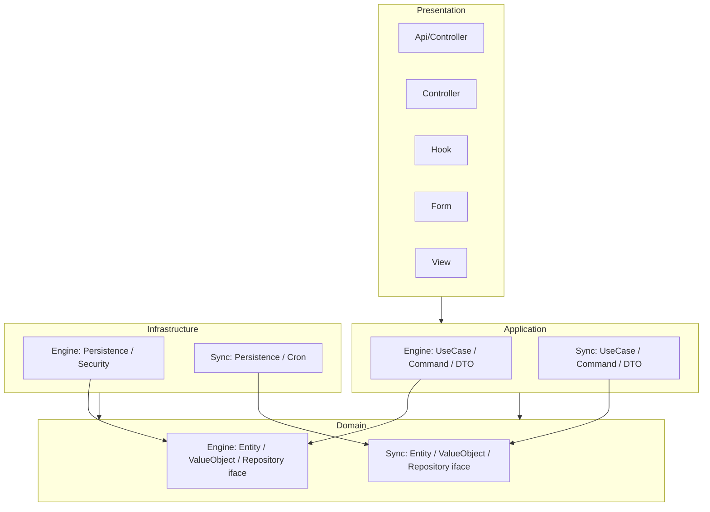

# ARCH-005 — Architecture globale UXConnector (squelette v2.0.0)

## Dépendances autorisées

| Couche         | Dépend de   |
| -------------- | ----------- |
| Presentation   | Application |
| Application    | Domain      |
| Infrastructure | Domain      |
| Domain         | Aucune      |

## Dépendances interdites

- `Domain → Infrastructure`
- `Domain → Presentation`
- `Domain → GLPI`
- `Application → Presentation`
- `Infrastructure → Presentation`

Voir [`ADR-001`](../adr/ADR-001-squelette-plugin.md).
